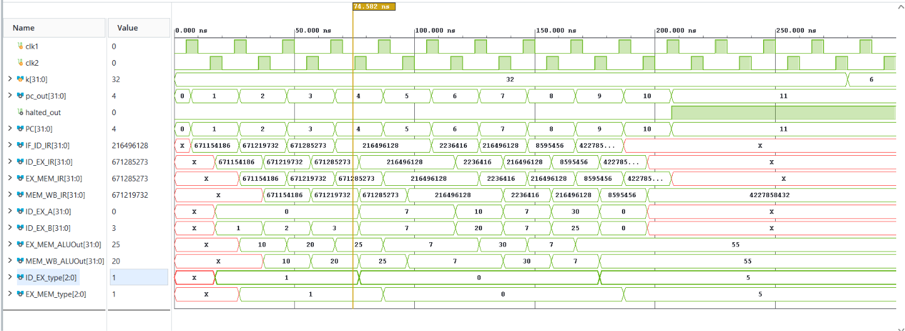
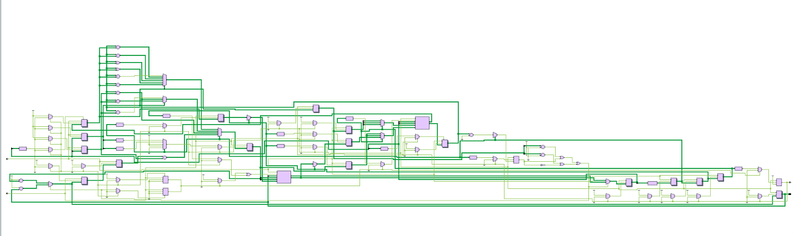

# 5-Stage Pipelined MIPS32 Processor

The `pipe_MIPS32` module is a synthesizable, 32-bit pipelined microprocessor core implemented in Verilog HDL (IEEE 1364-2001). Architected around the classic 5-stage RISC pipeline (Instruction Fetch, Instruction Decode/Register Fetch, Execute, Memory Access, and Write Back), the processor utilizes a two-phase non-overlapping clocking scheme (`clk1`, `clk2`) to synchronize datapath transitions and resolve structural register file access hazards. The core features a 32x32-bit general-purpose register file, Harvard memory separation, integer arithmetic and logic execution, load/store memory operations, conditional branch redirection, and a deterministic hardware halt mechanism.

## File Header

```text
// File name   : pipe_mips32.v
// Title       : 5-Stage Pipelined MIPS32 Processor
// Project     : mips32-processor-verilog
// Created     : 2026-10-30
// Description : Synthesizable 32-bit 5-stage pipelined MIPS RISC processor core with two-phase clocking
```

## Overview

Modern microprocessor datapath design relies on instruction-level pipelining to increase instruction throughput to an ideal single cycle per instruction ($CPI \approx 1$). This implementation models the 5-stage classic RISC pipeline:

1. **Instruction Fetch (IF)**: Samples instruction words from memory using the Program Counter (`PC`).
2. **Instruction Decode / Register Fetch (ID)**: Decodes instruction opcodes, extracts sign-extended immediates, and reads source operands from the register file.
3. **Execution (EX)**: Computes arithmetic, logical, and memory effective addresses using an internal ALU and evaluates branch conditions.
4. **Memory Access (MEM)**: Performs synchronous word-aligned reads and writes to data memory.
5. **Write Back (WB)**: Commits ALU execution results or loaded memory data into the destination register file or asserts the processor halt status.

### Digital Design Principles Utilized

- **Two-Phase Non-Overlapping Clocking**: Utilizes interleaved positive clock edges (`clk1` and `clk2`) to naturally decouple register file read and write cycles across pipeline boundaries without requiring multi-ported forwarding logic.
- **Inter-Stage Pipeline Registers**: Dedicated synchronous registers (`IF_ID_*`, `ID_EX_*`, `EX_MEM_*`, `MEM_WB_*`) isolate datapath stages, ensuring critical path delays are bounded to individual stage execution delays.
- **Branch Target & Condition Evaluation**: Dynamic branch evaluation during the EX stage with direct program counter override and flush control (`TAKEN_BRANCH`).
- **Register Zero Semantics**: Hardware-enforced zero register (`R0`) read gating (`(IF_ID_IR[25:21]==0 ? 0 : Reg[IF_ID_IR[25:21]])`) conforming to the standard MIPS ISA specification.

---

## Features

- **Verilog-2001 Synthesizable RTL**: Standards-compliant, highly portable register-transfer level code.
- **Classic 5-Stage RISC Pipeline**: Full hardware division into IF, ID, EX, MEM, and WB stages.
- **Two-Phase Clocking Discipline**: Alternating `clk1` and `clk2` phase synchronization preventing race conditions and read-after-write conflicts in the register file.
- **Comprehensive Instruction Set**: Supports Register-Register ALU (`ADD`, `SUB`, `AND`, `OR`, `SLT`, `MUL`), Register-Immediate ALU (`ADDI`, `SUBI`, `SLTI`), Memory Access (`LW`, `SW`), Control Flow (`BEQZ`, `BNEQZ`), and Execution Halt (`HLT`).
- **32-bit General Purpose Register File**: 32 registers (`Reg[0]` to `Reg[31]`), each 32 bits wide, with hardwired zero logic for `R0`.
- **Integrated Memory Arrays**: On-chip word-addressed instruction and data memory space (`Mem[0:1023]`).
- **Branch & Halt Diagnostics**: External monitoring ports (`pc_out`, `halted_out`) for real-time instruction progress tracing and pipeline state visualization.

---

## Architecture

The processor pipeline is segmented across five discrete stages synchronized across the two clock phases:

```text
                  Phase 1 (clk1)        Phase 2 (clk2)       Phase 1 (clk1)        Phase 2 (clk2)       Phase 1 (clk1)
               ┌──────────────────┐  ┌──────────────────┐  ┌──────────────────┐  ┌──────────────────┐  ┌──────────────────┐
               │    IF Stage      │  │    ID Stage      │  │    EX Stage      │  │    MEM Stage     │  │    WB Stage      │
               │                  │  │                  │  │                  │  │                  │  │                  │
  PC ─────────►│ Mem[PC]          ├──┼─► Reg Read /     ├──┼─► ALU / Target   ├──┼─► Mem Access /   ├──┼─► Reg Write /    │
               │ NPC = PC + 1     │  │   Sign-Extend    │  │   Condition Eval │  │   Data Routing   │  │   Halt Control   │
               └────────┬─────────┘  └────────┬─────────┘  └────────┬─────────┘  └────────┬─────────┘  └────────┬─────────┘
                        ▼                     ▼                     ▼                     ▼                     ▼
                  [ IF_ID_Regs ]        [ ID_EX_Regs ]        [ EX_MEM_Regs ]       [ MEM_WB_Regs ]       [ Reg File / HLT ]
```

### Detailed Pipeline Flow

1. **IF (clk1)**: Unless `HALTED`, reads `Mem[PC]`, increments Program Counter (`PC <= PC + 1`), and writes to `IF_ID_IR` and `IF_ID_NPC`. If a branch is taken from the EX stage, `PC` redirects to `EX_MEM_ALUOut + 1`.
2. **ID (clk2)**: Reads source registers `ID_EX_A` and `ID_EX_B` from `Reg`, generates 32-bit sign-extended immediate `ID_EX_Imm`, and classifies instruction type (`ID_EX_type`).
3. **EX (clk1)**: Computes the ALU output based on instruction type and opcode, calculates branch target addresses (`ID_EX_NPC + ID_EX_Imm`), and evaluates zero-condition comparison (`EX_MEM_cond <= (ID_EX_A == 0)`).
4. **MEM (clk2)**: Propagates ALU outputs, fetches data from `Mem[EX_MEM_ALUOut]` for load instructions (`LW`), or stores `EX_MEM_B` into `Mem[EX_MEM_ALUOut]` for store instructions (`SW`).
5. **WB (clk1)**: Commits calculated results or loaded data into `Reg[rd]` or `Reg[rt]`. Upon decoding `HLT`, asserts `HALTED <= 1'b1`, freezing the entire pipeline.

---

## Module Hierarchy

| Module Name | Type | Purpose | Source File |
|-------------|------|---------|-------------|
| `pipe_MIPS32` | Top / DUT | Synthesizable 5-stage pipelined 32-bit MIPS processor core | [`pipe_mips32.v`](pipe_mips32.v) |
| `test_mips32` | Testbench | Verification harness, two-phase clock generator, and benchmark loader | [`test_mips32.v`](test_mips32.v) |

---

## Interface (Ports & Parameters)

### Port List

| Port | Direction | Width | Type | Polarity / Trigger | Description |
|------|-----------|-------|------|--------------------|-------------|
| `clk1` | Input | `1` | `wire` | Positive Edge | Phase 1 system clock (synchronizes IF, EX, WB stages) |
| `clk2` | Input | `1` | `wire` | Positive Edge | Phase 2 system clock (synchronizes ID, MEM stages) |
| `pc_out` | Output | `32` | `wire` | Combinational | Continuous readout of the active Program Counter (`PC`) |
| `halted_out` | Output | `1` | `wire` | Combinational | Processor halt indicator flag; asserts high upon `HLT` retirement |

### Internal Pipeline Registers & Storage Elements

| Register Group | Registers | Bit Width | Description |
|----------------|-----------|-----------|-------------|
| **Instruction Fetch** | `PC`, `IF_ID_IR`, `IF_ID_NPC` | 32 bits | Program Counter, fetched Instruction Register, and Next PC |
| **Instruction Decode** | `ID_EX_IR`, `ID_EX_NPC`, `ID_EX_A`, `ID_EX_B`, `ID_EX_Imm` | 32 bits | Decoded instruction, operands A and B, and sign-extended immediate |
| | `ID_EX_type` | 3 bits | Encoded instruction category |
| **Execution** | `EX_MEM_IR`, `EX_MEM_ALUOut`, `EX_MEM_B` | 32 bits | Stage instruction, computed ALU result, and store data register |
| | `EX_MEM_cond` | 1 bit | Zero condition flag (`ID_EX_A == 0`) for conditional branches |
| | `EX_MEM_type` | 3 bits | Propagated instruction category |
| **Memory Access** | `MEM_WB_IR`, `MEM_WB_ALUOut`, `MEM_WB_LMD` | 32 bits | Stage instruction, forwarded ALU output, and Load Memory Data |
| | `MEM_WB_type` | 3 bits | Propagated instruction category |
| **Architectural State** | `Reg[0:31]` | 32 x 32 bits | General-Purpose Register File |
| | `Mem[0:1023]` | 1024 x 32 bits | Integrated word-addressed instruction and data memory |
| **Control Flags** | `HALTED`, `TAKEN_BRANCH` | 1 bit | Global execution halt flag and branch redirection active status |

---

## Instruction Set Architecture (ISA) & Opcodes

The processor decodes instruction categories in the ID stage (`ID_EX_type`) and performs operations defined by 6-bit opcodes (`IR[31:26]`):

### Supported Instruction Types (`type[2:0]`)

| Parameter | Binary Code | Category Description |
|-----------|-------------|----------------------|
| `RR_ALU` | `3'b000` | Register-Register Arithmetic and Logical Instructions |
| `RM_ALU` | `3'b001` | Register-Immediate (Register-Memory) Arithmetic Instructions |
| `LOAD` | `3'b010` | Memory Load Instructions |
| `STORE` | `3'b011` | Memory Store Instructions |
| `BRANCH` | `3'b100` | Conditional Branch Instructions |
| `HALT` | `3'b101` | Processor Halt Instruction |

### Opcode Mapping & Stage Operations

| Mnemonic | Opcode (`[31:26]`) | Type | Operation | Description |
|----------|-------------------|------|-----------|-------------|
| `ADD` | `6'b000000` (`00h`) | `RR_ALU` | `Reg[rd] <= Reg[rs] + Reg[rt]` | 32-bit integer addition |
| `SUB` | `6'b000001` (`01h`) | `RR_ALU` | `Reg[rd] <= Reg[rs] - Reg[rt]` | 32-bit integer subtraction |
| `AND` | `6'b000010` (`02h`) | `RR_ALU` | `Reg[rd] <= Reg[rs] & Reg[rt]` | Bitwise logical AND |
| `OR` | `6'b000011` (`03h`) | `RR_ALU` | `Reg[rd] <= Reg[rs] \| Reg[rt]` | Bitwise logical OR |
| `SLT` | `6'b000100` (`04h`) | `RR_ALU` | `Reg[rd] <= (Reg[rs] < Reg[rt])` | Set on less than (unsigned) |
| `MUL` | `6'b000101` (`05h`) | `RR_ALU` | `Reg[rd] <= Reg[rs] * Reg[rt]` | 32-bit integer multiplication |
| `LW` | `6'b001000` (`08h`) | `LOAD` | `Reg[rt] <= Mem[Reg[rs] + Imm]` | Load word from memory |
| `SW` | `6'b001001` (`09h`) | `STORE` | `Mem[Reg[rs] + Imm] <= Reg[rt]` | Store word to memory |
| `ADDI` | `6'b001010` (`0Ah`) | `RM_ALU` | `Reg[rt] <= Reg[rs] + Imm` | Add immediate |
| `SUBI` | `6'b001011` (`0Bh`) | `RM_ALU` | `Reg[rt] <= Reg[rs] - Imm` | Subtract immediate |
| `SLTI` | `6'b001100` (`0Ch`) | `RM_ALU` | `Reg[rt] <= (Reg[rs] < Imm)` | Set on less than immediate |
| `BNEQZ` | `6'b001101` (`0Dh`) | `BRANCH` | If `Reg[rs] != 0` &rarr; `PC <= NPC + Imm` | Branch if not equal to zero |
| `BEQZ` | `6'b001110` (`0Eh`) | `BRANCH` | If `Reg[rs] == 0` &rarr; `PC <= NPC + Imm` | Branch if equal to zero |
| `HLT` | `6'b111111` (`3Fh`) | `HALT` | `HALTED <= 1'b1` | Freezes processor execution |

---

## RTL Implementation Details

### Two-Phase Non-Overlapping Clock Synchronization

The design synchronizes sequential stages across two clock signals:

```text
       ┌───┐       ┌───┐       ┌───┐       ┌───┐
clk1 ──┘   └───────┘   └───────┘   └───────┘   └───  (Controls IF, EX, WB)
           ┌───┐       ┌───┐       ┌───┐       ┌───┐
clk2 ──────┘   └───────┘   └───────┘   └───────┘   └───  (Controls ID, MEM)
```

- **Phase 1 (`posedge clk1`)**: IF fetches instructions and increments `PC`; EX executes ALU calculations; WB commits writeback data to `Reg`.
- **Phase 2 (`posedge clk2`)**: ID reads operand registers from `Reg` and decodes the opcode; MEM reads/writes data memory `Mem`.
- **Race-Free Register File Access**: Because register file reads occur on `clk2` (ID) and register file writes occur on `clk1` (WB), the two accesses are separated by half a clock period, avoiding structural access collisions.

### Assignment Discipline & Transport Delays

- Non-blocking assignments with `#2` transport delays (`<= #2`) are utilized throughout the pipeline stages to model register propagation delays and prevent zero-delay race conditions in event-driven simulation engines.

### Branch Flushing & Hazard Management

- Branch conditions are evaluated in the EX stage (`EX_MEM_cond <= (ID_EX_A == 0)`).
- When a branch is taken (`((BEQZ && cond) || (BNEQZ && !cond))`), the IF stage redirects `PC` to `EX_MEM_ALUOut + 1` and asserts `TAKEN_BRANCH <= 1'b1`.
- The `TAKEN_BRANCH` signal gates the MEM stage from committing erroneous stores to memory (`if (!TAKEN_BRANCH) Mem[...] <= ...`) and blocks the WB stage from corrupting architectural registers.

---

## Verification

The processor verification environment is implemented in [`test_mips32.v`](test_mips32.v).

### Testbench Configuration

- **Two-Phase Clock Generation**: 20 ns total cycle period consisting of non-overlapping 5 ns pulses:
  ```verilog
  repeat(20) begin
      #5 clk1 = 1; #5 clk1 = 0;
      #5 clk2 = 1; #5 clk2 = 0;
  end
  ```
- **Register Initialization**: Registers `R0` through `R31` are initialized to their index values (`Reg[k] = k`).
- **Internal Signal Probing**: Binds pipeline registers (`IF_ID_IR`, `ID_EX_IR`, `EX_MEM_IR`, `MEM_WB_IR`, `EX_MEM_ALUOut`, `MEM_WB_ALUOut`) directly to wire probes for complete waveform inspection.

### Executed Benchmark Program

The testbench pre-loads the memory array (`Mem[0:8]`) with an assembly routine validating immediate arithmetic, dependency stalls/delay slots, multi-stage additions, and processor halting:

| Address | Machine Word | Assembly Instruction | Operation & Register State |
|---------|--------------|----------------------|----------------------------|
| `Mem[0]` | `32'h2801000a` | `ADDI R1, R0, 10` | `R1 <= 0 + 10 = 10` |
| `Mem[1]` | `32'h28020014` | `ADDI R2, R0, 20` | `R2 <= 0 + 20 = 20` |
| `Mem[2]` | `32'h28030019` | `ADDI R3, R0, 25` | `R3 <= 0 + 25 = 25` |
| `Mem[3]` | `32'h0ce77800` | `OR R15, R7, R7` | Delay slot / NOP (`R15 <= R7 \| R7 = 7`) |
| `Mem[4]` | `32'h0ce77800` | `OR R15, R7, R7` | Delay slot / NOP (`R15 <= R7 \| R7 = 7`) |
| `Mem[5]` | `32'h00222000` | `ADD R4, R1, R2` | `R4 <= R1 + R2 = 10 + 20 = 30` |
| `Mem[6]` | `32'h0ce77800` | `OR R15, R7, R7` | Delay slot / NOP (`R15 <= R7 \| R7 = 7`) |
| `Mem[7]` | `32'h00832800` | `ADD R5, R4, R3` | `R5 <= R4 + R3 = 30 + 25 = 55` |
| `Mem[8]` | `32'hfc000000` | `HLT` | Asserts `HALTED <= 1'b1`, freezing pipeline |

---

## Simulation Results

### Timing Waveforms



*Figure 1: Behavioral simulation waveform captured in AMD Vivado Simulator displaying two-phase clocking (`clk1`, `clk2`), sequential pipeline propagation of instruction words across `IF_ID_IR`, `ID_EX_IR`, `EX_MEM_IR`, and `MEM_WB_IR`, ALU result computation (`10`, `20`, `25`, `30`, `55`), and clean halt assertion (`halted_out = 1`) at ~200 ns.*

### Console Verification Logs

At 280 ns, the testbench displays the architectural register file state, confirming arithmetic calculations and register writeback integrity:

```text
Time resolution is 1 ps
R0 = 0
R1 = 10
R2 = 20
R3 = 25
R4 = 30
R5 = 55
$finish called at time : 300 ns : File "test_mips32.v" Line 98
```

---

## Schematics

### Elaborated RTL Schematic



*Figure 2: AMD Vivado elaborated design schematic of the top-level `pipe_MIPS32` processor showing inter-stage register banks, ALU logic multiplexers, condition comparators, and output ports (`pc_out`, `halted_out`).*

---

## How to Run Simulation

### Using Icarus Verilog (iverilog)

```bash
# Compile design and testbench
iverilog -g2001 -o mips32_sim.out pipe_mips32.v test_mips32.v

# Execute simulation
vvp mips32_sim.out
```

### Using AMD Vivado (xsim batch mode)

```bash
# Analyze Verilog sources
xvlog pipe_mips32.v test_mips32.v

# Elaborate testbench snapshot
xelab test_mips32 -s mips32_snapshot

# Run simulation to completion
xsim mips32_snapshot -R
```

---

## Technologies

- **Hardware Description Language**: Verilog HDL (IEEE 1364-2001)
- **Architecture**: 32-bit 5-Stage Pipelined RISC Core
- **EDA & Synthesis Suite**: AMD Vivado Design Suite
- **Logic Simulator**: AMD Vivado Simulator (XSim) / Icarus Verilog
- **Clocking Topology**: Two-Phase Non-Overlapping Synchronous Clocking

---

## Contributing

Contributions focusing on hardware hazard detection units, ALU operand forwarding networks, branch prediction, or standard ISA extensions are welcome:

1. Fork the repository
2. Create a feature branch (`git checkout -b feature/hazard-unit`)
3. Commit your changes
4. Verify simulation passes with 0 errors
5. Submit a Pull Request

---

&copy; Chethan Aithal. All rights reserved.

## Author

**Chethan Aithal**
